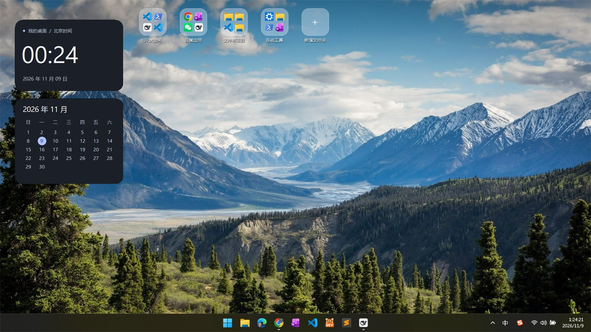

# MacDesk · Mac 风格桌面文件夹（Windows）

把 Windows 桌面变成一块深色玻璃台面：左侧是北京时间与月历卡片，上面是可拖动的“手机式文件夹”，点开后是一块屏幕正中的透明玻璃板，里面只有被玻璃盖住的图标。




## 特点

- **手机式文件夹**：文件夹是一格一格的深色方块，里面是最多 4 个图标的 2×2 预览。
- **居中玻璃板**：点开后从图标位置放大到屏幕正中，成为一块真正的毛玻璃面板（Win11 per-window Acrylic，能透出壁纸），背景轻微压暗。
- **只放图标**：面板里没有标题、没有搜索框、没有说明文字，只有玻璃盖住的图标和一个“＋”用来添加入口。
- **120Hz 动画**：动画由独立渲染线程按刷新节拍直接推帧（绕开 Windows 11 约 15.6ms 的定时器合并），260ms 展开、190ms 收起，两端缓入缓出。
- **真实拖放**：把文件、文件夹、快捷方式、网址拖到面板任意位置即可加入；原文件不会被移动。图标可拖动排序，也可跨文件夹移动。
- **自动保存**：所有改动写入 JSON 并保留带哈希的备份，原子替换，不会写坏配置。
- **不接管系统**：不修改 Explorer、不注入钩子、不改系统壁纸与主题、不隐藏任务栏；退出后桌面立刻恢复。

## 系统要求

- Windows 11（玻璃效果依赖 Win11 的 Acrylic；其他系统会回退为不透明面板）
- .NET Framework 4.x（系统自带）
- 不需要安装任何运行时、不需要管理员权限

## 构建

```powershell
pwsh -File .\build.ps1
# 产物：build\MacDeskNative.exe
```

也可以直接用 csc 编译 `src` 下 9 个文件，带上 `src\Native.manifest`（需要 DPI 感知与 Win10/11 兼容声明）。

## 运行

```powershell
.\build\MacDeskNative.exe --root "D:\MacDesk"
```

`--root` 指定配置目录，首次运行会创建：

```
D:\MacDesk\
  desktop.json          # 文件夹与入口数据
  Backups\              # 每次保存前的带哈希备份
```

想让它在登录后自动启动，把快捷方式放进：

```
%APPDATA%\Microsoft\Windows\Start Menu\Programs\Startup
```

快捷键：`Ctrl+F` 聚焦搜索（旧版本功能，当前面板已无搜索框）、`Esc` 关闭面板、`F2` 重命名入口、`Delete` 移除入口、`Ctrl+N` 新增入口。

## 数据结构

`desktop.json` 里是分组与入口：

```json
{
  "version": 1,
  "groups": [
    {
      "id": "dev",
      "title": "开发空间",
      "subtitle": "代码 · 终端",
      "items": [
        { "id": "...", "title": "VS Code", "description": "", "type": "app",
          "target": "C:\\...\\Code.exe", "icon": "", "arguments": "" }
      ],
      "desktopX": 440,
      "desktopY": 24
    }
  ]
}
```

保存时先克隆数据、校验、再做 SHA256 比对与原子替换，失败会回滚，不会出现半截文件。

## 设计说明

- [docs/ARCHITECTURE.md](docs/ARCHITECTURE.md)：窗口拓扑、玻璃实现、动画节拍、拖放与保存流程。

## 已知限制

- 仅 Windows；玻璃与圆角依赖 Win11 合成器。
- 动画期间会有一个 CPU 核心接近满载（最长 260ms），换来贴满 120Hz 的顺滑；动画结束线程即退出。
- 单显示器为主；多显示器时面板跟随来源文件夹所在屏幕。

## 声明

个人自用项目，按现状提供。图标与壁纸版权归各自所有者。
