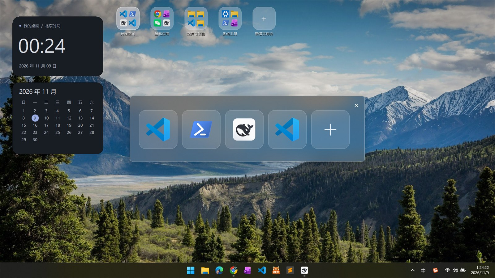

# MacDesk · Mac 风格桌面文件夹（Windows）

把 Windows 桌面做成 iPhone 主屏幕的手感：左侧是 iOS 风格的时钟与日历小组件，上方是毛玻璃文件夹，点开后像 iOS 一样从图标展开成一块居中的玻璃面板，背景整屏模糊压暗。

> 下面两张截图是旧版界面，当前版本的外观见上文描述。




## 特点

- **iOS 式文件夹**：圆角毛玻璃方块使用真实壁纸做模糊，3×3 预览显示最多九个应用。点开可直接启动分类里的应用。文件、目录、网址和系统快捷方式可从托盘的「其他快捷入口」打开。
- **展开动画**：iOS 式共享元素过渡——外框从桌面图标长成居中面板，缩略图里的 9 个小图标各自飞到自己的格子，整屏模糊压暗同步进行；全程一个窗口、一个进度值，中途可反向，无交接、无跳变。
- **面板**：大标题在面板上方（点一下即可重命名），图标下方常驻名称；直接打字即搜索（含其他文件夹），“＋”进入 iOS 式添加页（蓝色勾选）。
- **干净桌面**：运行时隐藏 Windows 桌面图标。在托盘退出 MacDesk 后恢复启动前的显示状态。可以从托盘打开桌面目录，再将桌面快捷方式拖到玻璃框对应的分类。单击框里的应用图标即可启动。
- **提醒事项**：日历下方是 iOS 风格的「提醒事项」小组件，列出逾期、今天和未定日期的待办；点圆圈完成（打勾动画，稍后淡出，下面的行补上），点「＋」直接新建。
- **日程卡片**：点日历上的任一天，旁边弹出这一天的玻璃卡片：当天的提醒事项和一行备注。直接打字就能新建，回车后接着新建下一条；右键可改到今天、明天、推迟一周或删除。有提醒事项或备注的日期下方有小圆点。
- **统一的视觉**：确认删除、错误提示、新建 / 重命名文件夹都是和面板同一种不抢焦点的毛玻璃弹层；「编辑入口」表单也换成同一套深色、圆角和字号。
- **自动避让**：时钟和日历移动时，玻璃框根据两侧可用空间重排。
- **按显示器刷新率出帧**：所有动画（悬停、按下、回流、滚动、展开收起）都由弹簧驱动并按 DWM 垂直同步出帧，本机 240Hz 上实测展开约 120fps、收起约 180fps。
- **不抢焦点**：打开文件夹不会激活任何窗口，所以 Win+D（显示桌面）状态下点文件夹，其他窗口不会被全部还原回来；键盘输入（搜索、Esc、方向键、1–9、F2）经桌面层转发，中文输入法候选框会跟到输入位置。
- **真实拖放**：把文件、文件夹、快捷方式、网址拖到面板任意位置即可加入；原文件不会被移动。图标可拖动排序，也可跨文件夹移动。
- **自动保存**：所有改动写入 JSON 并保留带哈希的备份，原子替换，不会写坏配置。
- **不接管系统**：不修改 Explorer、不注入钩子、不改系统壁纸与主题、不隐藏任务栏；退出后桌面立刻恢复。

## 系统要求

- Windows 11（毛玻璃由程序自行模糊壁纸 / 屏幕截图实现，不依赖 Acrylic）
- .NET Framework 4.x（系统自带）
- 不需要安装任何运行时、不需要管理员权限

## 构建

```powershell
powershell -NoProfile -ExecutionPolicy Bypass -File .\build.ps1
# 编译到 build\MacDesk.exe，再复制到 Documents\MacDesk\MacDesk.exe
```

本机的执行策略会拦截未签名脚本，所以需要 `-ExecutionPolicy Bypass`。重新编译前先从托盘退出 MacDesk，否则正在运行的 exe 无法被覆盖。

代码分三层：`src\Core`（后端，唯一入口 `DeskService`，契约见 [docs/BACKEND_API.md](docs/BACKEND_API.md)）、`src\UI`（界面与动画）、`src\Host`（入口与桌面挂载）。`build.ps1` 会先单独编译 `src\Core`，确认它不依赖界面代码，再编译出单个 exe；加 `-NoDeploy` 只编译不部署。

测试：`MacDesk.exe --self-test`（后端 + 前端自测，退出码 0 为通过）；`MacDesk.exe --bench`（离屏渲染性能测试，结果写在 exe 旁的 bench.txt）。

## 运行

```powershell
& "$env:USERPROFILE\Documents\MacDesk\MacDesk.exe"
```

也可以双击 `启动MacDesk.cmd` 或 `MacDesk.lnk`，两者都启动 Documents 里的副本。

> 不要直接运行 `build\` 下的 exe：仓库所在目录带 Low Mandatory Level 标签，从那里启动的进程是低完整性，会被 SmartScreen 拦截，也无法挂到 Explorer 的桌面窗口下。

默认配置目录是 `%LOCALAPPDATA%\MacDesk`；用 `--root` 可以另指一个目录，例如 `--root "D:\MacDesk"`，首次运行会创建：

```
D:\MacDesk\
  desktop.json          # 文件夹与入口数据
  Backups\              # 每次保存前的带哈希备份
```

想让它在登录后自动启动，把快捷方式放进：

```
%APPDATA%\Microsoft\Windows\Start Menu\Programs\Startup
```

快捷键（文件夹打开时）：直接打字即搜索、`Ctrl+F` 切换搜索、`Esc` 退出搜索 / 关闭文件夹、方向键选择、`Enter` 打开、`1`–`9` 快速打开、`F2` 重命名、`Delete` 移除入口、`Ctrl+N` 添加应用。

快捷键（日程卡片打开时）：直接打字新建提醒事项、`Enter` 保存并接着新建、`Esc` 取消输入 / 关闭卡片、`↑` `↓` 滚动。

## 数据结构

`desktop.json` 里是分组与入口、日历备注和提醒事项（版本 1 的旧文件会自动升级）：

```json
{
  "version": 2,
  "groups": [
    {
      "id": "dev",
      "title": "开发空间",
      "subtitle": "代码 · 终端",
      "items": [
        { "id": "...", "title": "VS Code", "description": "", "type": "app",
          "target": "C:\\...\\Code.exe", "icon": "", "arguments": "" }
      ],
      "desktopX": -1,
      "desktopY": -1
    }
  ],
  "notes": { "2026-11-23": "下午三点评审" },
  "todos": [
    { "id": "...", "title": "发布检查", "done": false, "due": "2026-11-23",
      "created": "2026-11-22T08:00:00Z", "completed": "" }
  ]
}
```

保存时先克隆数据、校验、再做 SHA256 比对与原子替换，失败会回滚，不会出现半截文件。

## 设计说明

- [docs/ARCHITECTURE.md](docs/ARCHITECTURE.md)：窗口拓扑、玻璃实现、动画节拍、拖放与保存流程。

## 已知限制

- 仅 Windows 11；毛玻璃取样的是主显示器上的壁纸（填充 / 适应 / 拉伸 / 居中 / 平铺）与打开瞬间的屏幕截图。
- 动画按显示器刷新率由独立线程出帧（DwmFlush 节拍，不空转 CPU）；面板帧只拼接预渲染好的图标与文字。
- 单显示器为主；多显示器时面板跟随来源文件夹所在屏幕。

## 声明

个人自用项目，按现状提供。图标与壁纸版权归各自所有者。
